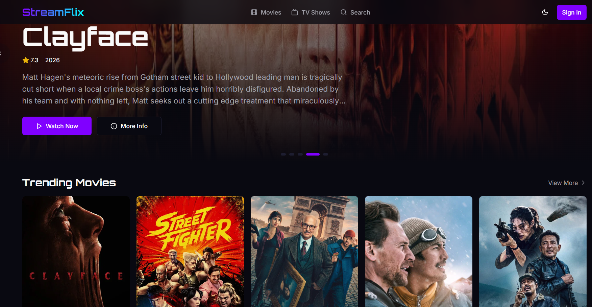
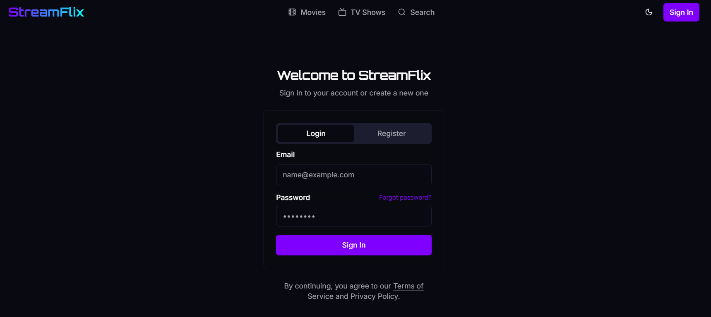
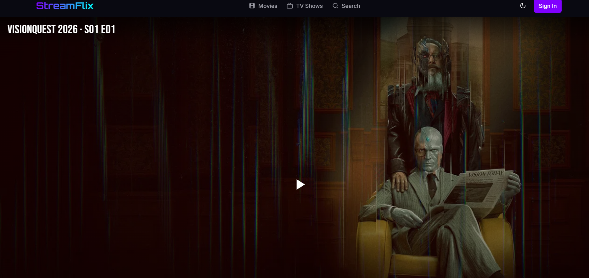

# 🎬 StreamFlix

<div align="center">
  
  
  <p><em>✨ Premium Movie and TV Show Streaming Platform ✨</em></p>

  <div>
    
    
    
    
  </div>
</div>

## 📸 Screenshots

The screenshots below are stored in the [`ss/`](ss/) folder.

<div align="center">
  <figure>
    
    <figcaption>Home page</figcaption>
  </figure>
  <figure>
    
    <figcaption>Sign in</figcaption>
  </figure>
  <figure>
    
    <figcaption>Video player</figcaption>
  </figure>
</div>

## 📋 Overview

StreamFlix is a modern, responsive streaming platform built with Next.js that allows users to browse and watch movies and TV shows. It features a sleek UI, comprehensive search functionality, and integration with TMDB for metadata and VidSrc for streaming sources.

### ✨ Live Demo

[](https://v0-create-a-php-project.vercel.app/)

## 🚀 Features

<div align="center">
  <table>
    <tr>
      <td><b>🎭 Extensive Library</b></td>
      <td>Thousands of movies and TV shows</td>
    </tr>
    <tr>
      <td><b>🔍 Advanced Search</b></td>
      <td>Find content by title, genre, or actor</td>
    </tr>
    <tr>
      <td><b>📱 Responsive Design</b></td>
      <td>Optimized for all devices</td>
    </tr>
    <tr>
      <td><b>🌓 Dark/Light Mode</b></td>
      <td>Choose your preferred theme</td>
    </tr>
    <tr>
      <td><b>📺 HD Streaming</b></td>
      <td>High-quality video playback</td>
    </tr>
    <tr>
      <td><b>📝 User Accounts</b></td>
      <td>Track watch history and favorites</td>
    </tr>
  </table>
</div>

## 🛠️ Tech Stack

<div align="center">
  
</div>

### Frontend
- Next.js 13+ (App Router)
- TypeScript
- Tailwind CSS
- Shadcn UI Components
- Lucide React Icons

### APIs & Services
- TMDB API (The Movie Database)
- VidSrc API (Streaming Sources)

## 🧩 Open-source projects

StreamFlix is built with these open-source projects:

- [Next.js](https://github.com/vercel/next.js)
- [React](https://github.com/facebook/react) and [TypeScript](https://github.com/microsoft/TypeScript)
- [Tailwind CSS](https://github.com/tailwindlabs/tailwindcss)
- [shadcn/ui](https://github.com/shadcn-ui/ui) and [Lucide](https://github.com/lucide-icons/lucide)

## 🚀 Getting Started

### Prerequisites
- Node.js 18.0 or later
- TMDB API Key ([Get one here](https://www.themoviedb.org/settings/api))

### Installation

```bash
# Clone the repository
git clone https://github.com/yaratul2005/StreamFlix.git
cd StreamFlix

# Install dependencies
npm install

# Set up environment variables
echo "TMDB_API_KEY=your_tmdb_api_key_here" > .env.local
echo "NEXT_PUBLIC_APP_URL=http://localhost:3000" >> .env.local

# Run the development server
npm run dev
```

